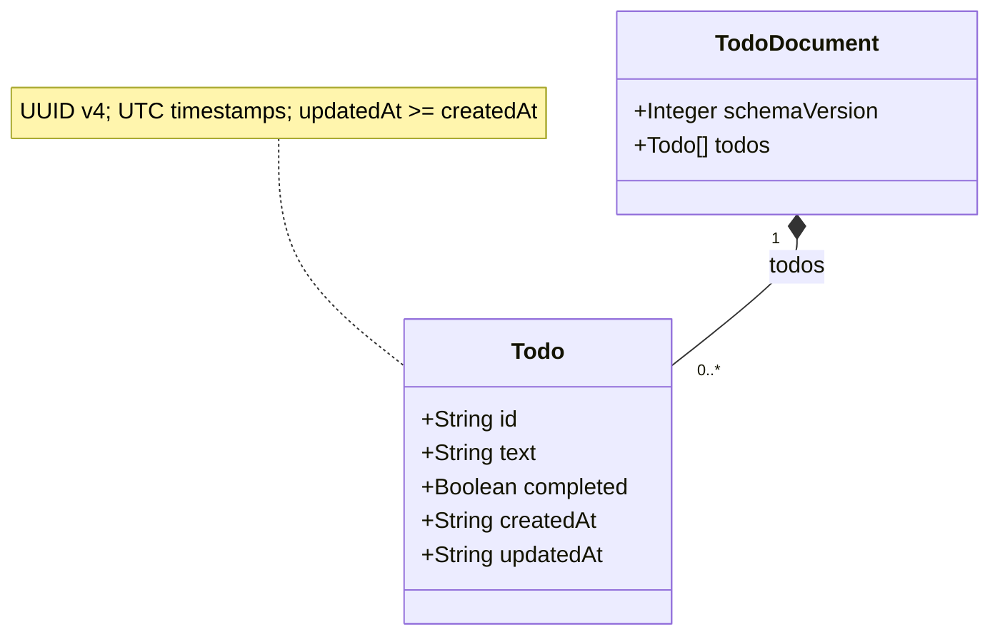
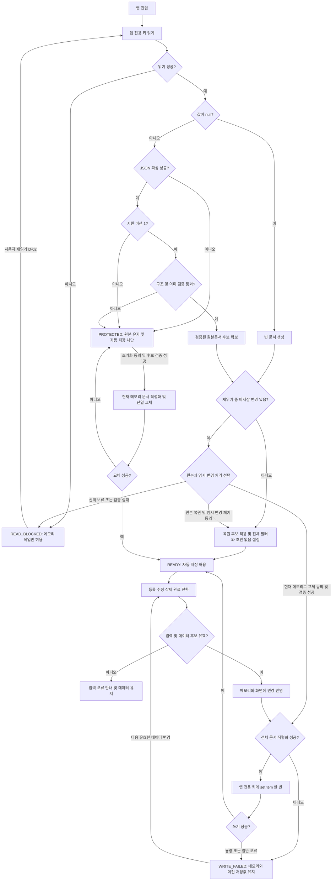
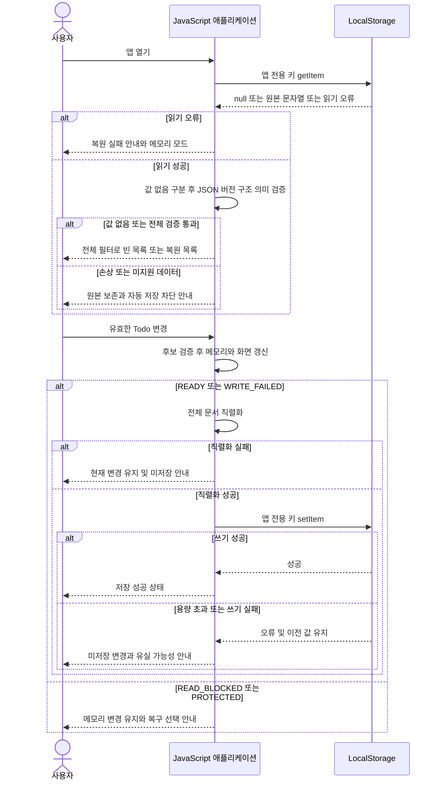
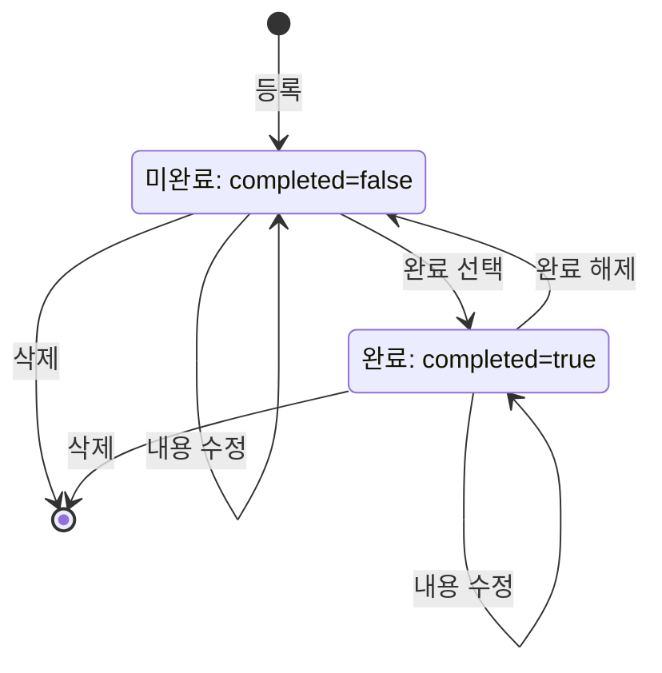

# LocalStorage 데이터 모델 설계

관련 Issue: [#7](https://github.com/hanyong5/2026testcode/issues/7)

기준 문서: [기능 요구사항](requirements.md), [사용자 시나리오 및 화면 흐름](user-scenarios.md)

## 1. 설계 목적과 범위

Todo 데이터를 같은 브라우저·동일 출처에서 일관되게 저장하고 안전하게 복원할 계약을 정의합니다.
HTML5·CSS3·Vanilla JavaScript·LocalStorage 및 단일 탭 범위를 유지합니다.
이 문서는 설계 산출물입니다. 실제 CRUD·LocalStorage 기능 코드는 작성하지 않습니다.
새 데이터 구조와 D-02 복구 정책은 이 PR의 설계안이며 리뷰·병합 후 구현 기준으로 사용합니다.
D-01 편집 전환과 D-03 포커스 이동 정책은 변경하지 않습니다.

| 요구사항 | 연결 시나리오 | 데이터 설계 반영 |
|---|---|---|
| FR-01~FR-04 CRUD | US-02~US-04 | 고유 ID, 정규화된 text, 배열 순서, 변경 대상 식별 |
| FR-05~FR-06 완료·필터 | US-05~US-06 | completed 불리언, 숨겨진 항목 보존, 조회·필터는 저장하지 않음 |
| FR-07 입력 검증 | US-08 | trim 후 1~200 코드포인트, 한 줄, HTML도 텍스트로 취급 |
| FR-08 빈 목록 | US-01, US-09 | todos 빈 배열과 현재 필터의 빈 결과를 구분 |
| FR-09 저장·복원 | US-07 | 전체 스냅샷, 표시 순서 보존, 필터·편집 초안 제외 |
| FR-10 데이터 보호 | US-10~US-12, D-02 | 오류 분류, 쓰기 차단, 원본 보존, 명시적 교체 동의 |

## 2. Todo와 저장 문서

### Todo 필드 정의

모든 필드는 저장 시 필수입니다. 복원할 때 누락된 값을 기본값으로 보충하지 않습니다.

| 필드 | JSON 타입 | 필수 | 생성 기본값 | 제약 및 변경 정책 |
|---|---|---|---|---|
| id | string | 예 | 새 UUID v4 | 소문자 정규형, 문서 내 유일. 생성 후 불변 |
| text | string | 예 | 없음 | 앞뒤 공백 제거 후 1~200 코드포인트, 한 줄. 중복 내용 허용 |
| completed | boolean | 예 | false | true/false만 허용. 문자열·숫자로 변환하지 않음 |
| createdAt | string | 예 | 생성 시각 t | UTC 밀리초 ISO 문자열. 생성 후 불변 |
| updatedAt | string | 예 | createdAt과 같은 t | 내용 또는 완료 상태의 실제 변경 시 갱신. createdAt 이상 |

날짜는 `2026-11-15T01:10:00.000Z`처럼 `YYYY-MM-DDTHH:mm:ss.sssZ` 형식으로 저장합니다.
JSON에는 Date 객체, undefined, 함수, 순환 참조를 넣지 않습니다.

### 저장 문서 필드 정의

| 필드 | JSON 타입 | 필수 | 초기값 | 제약 |
|---|---|---|---|---|
| schemaVersion | integer | 예 | 1 | 이 문서의 지원 버전은 1 |
| todos | array of Todo | 예 | [] | 전체 Todo를 최신 등록 항목부터 보관. 저장·복원 시 순서 유지 |

배열의 순서가 표시 순서의 기준입니다. createdAt·updatedAt·ID로 다시 정렬하지 않습니다.
시계가 역행하거나 생성 시각이 같아도 새 항목은 배열 맨 앞에 추가합니다.
수정·완료 전환·필터 변경은 순서를 바꾸지 않습니다.

`selectedFilter`, 편집 초안, 입력 오류, 저장 상태, 미저장 여부는 메모리 전용입니다.
재방문 시 필터는 전체, 편집 초안은 없음으로 시작합니다.

## 3. ID와 시각 관리 정책

### ID 생성과 중복 방지

1. 생성에는 암호학적 난수 기반 UUID v4인 `crypto.randomUUID()`를 사용합니다.
2. 실행 환경은 API를 사용할 수 있는 secure context를 전제로 합니다. API가 없으면 임의의 낮은 품질 ID를 만들지 않고 등록 실패를 안내합니다. 기존 Todo 조회는 유지합니다.
3. 새 ID를 필터링 전 전체 메모리 목록의 ID 집합과 비교합니다. 충돌 시 새 UUID를 다시 생성하며 총 3회까지 시도합니다.
4. 모두 충돌하거나 생성에 실패하면 항목을 추가·저장하지 않고 입력 내용과 오류 안내를 유지합니다.
5. text 중복은 허용하지만 id 중복은 허용하지 않습니다. 복원 데이터의 중복 ID는 문서 전체 검증 실패로 처리합니다.

`Math.random()`이나 시각 값만을 ID로 사용하는 정책은 채택하지 않습니다.
UUID는 항목 식별자이며 인증·권한 수단으로 사용하지 않습니다.
API 특성은 [MDN randomUUID](https://developer.mozilla.org/en-US/docs/Web/API/Crypto/randomUUID)를 기준으로 합니다.

### createdAt과 updatedAt

- 생성: 동일한 현재 UTC 밀리초 시각을 두 필드에 부여합니다.
- 내용 수정·완료 전환: 새 updatedAt은 현재 시각과 이전 updatedAt + 1ms 중 큰 값으로 정합니다. 시스템 시계 역행으로 이전 시각보다 작아지지 않게 합니다.
- 취소·유효하지 않은 입력·정규화 결과가 같은 내용 저장·이미 같은 완료 상태 지정·조회·필터 변경·저장 재시도는 두 시각을 바꾸지 않습니다.
- 삭제는 항목을 제거하며 삭제 이력이나 별도 deletedAt은 저장하지 않습니다.
- 복원 시 두 시각을 새로 만들지 않습니다. 실제 달력 시각인지, UTC 정규형인지, updatedAt이 createdAt 이상인지 검증합니다.

## 4. JSON 저장 예시

### 최초 메모리 상태

```json
{"schemaVersion": 1, "todos": []}
```

저장 키가 없으면 이 상태로 시작합니다. 최초 진입만으로 빈 값을 기록하지 않고 첫 유효한 데이터 변경 시 저장합니다.

### 저장·복원할 문서 예시

```json
{
  "schemaVersion": 1,
  "todos": [
    {
      "id": "a4a1ac82-7c0d-4d62-a629-81624ac59de1",
      "text": "LocalStorage 데이터 모델 검토",
      "completed": false,
      "createdAt": "2026-11-15T01:10:00.000Z",
      "updatedAt": "2026-11-15T01:10:00.000Z"
    },
    {
      "id": "fb9cf69b-1930-4e40-90aa-6eb92e8468bc",
      "text": "사용자 시나리오 확인",
      "completed": true,
      "createdAt": "2026-11-15T01:00:00.000Z",
      "updatedAt": "2026-11-15T01:05:00.000Z"
    }
  ]
}
```

LocalStorage 값은 위 객체를 JSON으로 직렬화한 문자열입니다. 이중 직렬화한 문자열이나 Todo 배열만 저장하지 않습니다.

## 5. JSON Schema

Draft 2020-12를 사용합니다. `default`는 생성 정책을 설명하는 주석이며 검증기가 값을 자동 보충한다는 뜻이 아닙니다.
`required` 누락은 실패해야 하며 타입 강제 변환·미등록 필드 자동 제거도 사용하지 않습니다.
`format`은 기본 방언에서 주석일 수 있으므로 검증 도구에서 uuid·date-time 검사를 명시적으로 활성화합니다.
이는 [JSON Schema 검증 명세](https://json-schema.org/draft/2020-12/json-schema-validation)의 format·default 규칙에 따릅니다.

```json
{
  "$schema": "https://json-schema.org/draft/2020-12/schema",
  "title": "TodoDocument v1",
  "type": "object",
  "additionalProperties": false,
  "required": [
    "schemaVersion",
    "todos"
  ],
  "properties": {
    "schemaVersion": {
      "type": "integer",
      "const": 1,
      "default": 1
    },
    "todos": {
      "type": "array",
      "default": [],
      "items": {
        "$ref": "#/$defs/Todo"
      }
    }
  },
  "$defs": {
    "UtcTimestamp": {
      "type": "string",
      "format": "date-time",
      "pattern": "^\\d{4}-\\d{2}-\\d{2}T\\d{2}:\\d{2}:\\d{2}\\.\\d{3}Z$",
      "minLength": 24,
      "maxLength": 24
    },
    "Todo": {
      "type": "object",
      "additionalProperties": false,
      "required": [
        "id",
        "text",
        "completed",
        "createdAt",
        "updatedAt"
      ],
      "properties": {
        "id": {
          "type": "string",
          "format": "uuid",
          "pattern": "^[0-9a-f]{8}-[0-9a-f]{4}-4[0-9a-f]{3}-[89ab][0-9a-f]{3}-[0-9a-f]{12}$",
          "minLength": 36,
          "maxLength": 36
        },
        "text": {
          "type": "string",
          "minLength": 1,
          "maxLength": 200,
          "pattern": "\\S",
          "not": {
            "pattern": "[\\r\\n\\u2028\\u2029]"
          }
        },
        "completed": {
          "type": "boolean",
          "default": false
        },
        "createdAt": {
          "$ref": "#/$defs/UtcTimestamp"
        },
        "updatedAt": {
          "$ref": "#/$defs/UtcTimestamp"
        }
      }
    }
  }
}
```

### 스키마 이후 필수 의미 검증

JSON Schema 통과만으로 데이터가 모두 유효하다고 판단하지 않습니다.

| 규칙 | 추가 검증 | 실패 시 처리 |
|---|---|---|
| ID 유일성 | todos 전체의 id가 서로 다름 | 전체 복원 차단·원본 유지 |
| text 정규화 | 저장 text가 ECMAScript trim 결과와 동일하고 비어 있지 않음 | 전체 복원 차단·원본 유지 |
| 날짜 정규형 | 실제 달력 시각이며 UTC 밀리초 형식으로 다시 표현했을 때 원문과 동일 | 전체 복원 차단·원본 유지 |
| 날짜 순서 | 각 Todo의 updatedAt이 createdAt 이상 | 전체 복원 차단·원본 유지 |

`uniqueItems`는 객체 전체의 중복을 검사하므로 id만 같은 서로 다른 객체를 막는 대체 수단으로 사용하지 않습니다.
JSON Schema의 문자열 길이는 코드포인트 기준으로 검증하며 JavaScript의 UTF-16 코드 단위 길이와 혼동하지 않습니다.
정규식만으로 문자열 trim 정규형이나 두 날짜의 선후 관계를 보장한다고 간주하지 않습니다.

## 6. LocalStorage 저장 정책

| 항목 | 결정 |
|---|---|
| 앱 전용 키 | `2026testcode:todo-list:data` |
| 명명 규칙 | `<repository>:<application>:<purpose>`의 소문자 이름공간 |
| 버전 위치 | 키는 유지하고 문서의 schemaVersion으로 식별 |
| 저장 단위 | 필터에 숨겨진 항목을 포함한 문서 전체 스냅샷 |
| 저장 시점 | 유효한 등록·수정·삭제·완료 전환 이후 |
| 비저장 동작 | 최초 빈 진입·조회·필터 변경·편집 시작·취소·무효 입력·실질적 변화 없음 |
| 직렬화 | 검증된 일반 JSON 값만 JSON.stringify로 한 번 직렬화 |
| 저장 방식 | 앱 전용 키에 setItem 한 번으로 교체. removeItem·clear 선행 금지 |
| 저장 성공 기준 | setItem이 오류 없이 끝난 뒤 마지막 저장 성공 스냅샷과 상태 갱신 |
| 실패 | 메모리 변경과 마지막 저장값을 유지하고 실패 안내. 성공으로 표시하지 않음 |

문자열 저장과 용량 오류는 [MDN setItem](https://developer.mozilla.org/en-US/docs/Web/API/Storage/setItem),
값을 저장할 수 없을 때 교체 전에 오류를 발생시키는 동작은 [Web Storage 명세](https://html.spec.whatwg.org/multipage/webstorage.html#dom-storage-setitem-dev)를 기준으로 합니다.
이 계약은 단일 키 교체의 실패 보호이며 여러 키의 트랜잭션·다중 탭 충돌 해결·영구 보관을 보장하지 않습니다.
출처는 프로토콜·호스트·포트 기준입니다. 경로만으로 격리되지 않으므로 키 이름공간을 사용하며 다른 앱의 키는 수정하지 않습니다.

### CRUD 처리 흐름

| 동작 | 메모리 변경 | 검증·시각 | 저장 결과 및 화면 |
|---|---|---|---|
| 등록 | 새 Todo를 배열 맨 앞에 추가 | 입력 정규화·ID 충돌 확인·초기 completed=false·두 시각 동일 | 전체 문서 저장 후 현재 필터로 표시 |
| 조회·필터 | 원본 문서 변경 없음 | 필요 시 표시 조건만 계산 | 저장 없음. 전체·진행 중·완료 결과만 변경 |
| 내용 수정 | ID로 대상만 변경 | 유효한 다른 내용일 때 updatedAt 갱신. id·createdAt·완료 상태·위치 유지 | 전체 문서 저장·현재 필터 유지 |
| 완료 전환 | 대상 completed만 전환 | 실제 상태 변경 시 updatedAt 갱신 | 전체 문서 저장. 필터에서 숨겨져도 데이터 보존 |
| 삭제 | ID로 대상만 제거 | 다른 항목의 시각·순서 유지 | 남은 전체 문서 저장. 마지막 항목 삭제도 빈 문서 저장 |
| 편집 취소·잘못된 입력 | Todo 변경 없음 | 편집 초안만 유지 또는 취소 | 저장 없음 |

정상 변경의 순서는 입력 검증 → 데이터 후보 생성·구조/의미 검증 → 메모리·화면 반영 → 저장 허용 상태 확인 → 직렬화·쓰기입니다.
쓰기 실패 후에도 화면 변경을 유지하는 FR-10을 따릅니다. 재시도는 현재의 전체 메모리 문서를 사용하며 타임스탬프를 새로 만들지 않습니다.

### 복원 처리 흐름

1. LocalStorage 객체 접근과 getItem을 오류 처리 범위에 포함합니다. 읽기 실패 시 저장이 차단된 메모리 모드로 진입합니다.
2. 값이 null이면 정상적인 최초 빈 문서를 사용합니다. 빈 문자열은 키 부재와 구분하며 JSON 파싱 실패입니다.
3. JSON.parse 후 객체·schemaVersion을 확인합니다. 지원하지 않는 버전은 임의로 현재 버전으로 바꾸지 않습니다.
4. v1 구조 검증과 필수 의미 검증을 모두 통과한 경우에만 전체 목록을 복원합니다.
5. 검증 실패 시 일부 항목만 복원하거나 필드를 보정해 덮어쓰지 않습니다. 원본은 저장소에 남기고 메모리 빈 목록·오류 안내·저장 차단 상태를 유지합니다.
6. 성공 시 배열 순서를 유지하고 전체 필터·편집 초안 없음으로 시작합니다. 복원 자체로는 다시 저장하지 않습니다.

## 7. 예외 처리와 사용자 안내

| 분류 | 메모리와 저장 데이터 | 안내 예시 | 재시도·복구 |
|---|---|---|---|
| 입력·후보 검증 실패 | Todo 변경·저장 없음, 입력 초안 유지 | 올바른 한 줄 내용을 입력해 주세요 | 유효한 입력으로 재제출 |
| JSON 파싱 실패 | 빈 메모리 목록·원본 값 유지·자동 쓰기 차단 | 저장 데이터를 읽을 수 없습니다. 초기화 전에는 원본을 유지합니다 | 명시적 초기화 동의 필요 |
| 구조·의미 불일치 | ID 중복·타입 오류 등을 부분 보정하지 않고 전체 복원 차단 | 저장 데이터 형식이 맞지 않습니다 | 원본 유지·초기화 동의 또는 지원 버전에서 복구 |
| 미지원 버전 | 원본 유지·자동 쓰기 및 다운그레이드 차단 | 이 데이터 버전은 현재 앱에서 지원하지 않습니다 | 지원 앱으로 열기 또는 명시적 초기화 동의 |
| 읽기 제한·SecurityError | 빈 메모리 작업 허용·원본 미확인·자동 쓰기 차단 | 저장소에 접근하지 못했습니다. 현재 작업의 저장·복원을 보장할 수 없습니다 | D-02 재읽기 절차 적용 |
| QuotaExceededError | 화면 변경·마지막 저장값 유지 | 저장 공간이 부족합니다. 현재 변경은 새로고침하면 사라질 수 있습니다 | 사용자가 불필요한 Todo를 삭제하는 다음 변경에서 전체 저장 재시도 |
| 일반 쓰기 실패·권한 변경 | 화면 변경·마지막 저장값 유지 | 저장하지 못했습니다. 마지막 저장 상태로 돌아갈 수 있습니다 | 다음 데이터 변경 시 재시도. 읽기 불가도 확인되면 보호 모드 적용 |
| 직렬화 실패 | 화면 변경·마지막 저장값 유지, 저장 성공 표시 안 함 | 저장할 데이터에 문제가 있습니다. 현재 변경은 저장되지 않았습니다 | 후보 검증·문제 원인 확인 후 다음 변경에서 재시도 |

용량은 고정 Todo 개수나 문자열 길이 합만으로 성공을 보장하지 않습니다. 실제 쓰기 오류를 처리합니다.
공간 확보를 위해 다른 앱의 키를 지우거나 Todo를 몰래 자르거나 삭제하지 않습니다.
원시 저장 데이터·인증 토큰·로컬 환경변수는 사용자 안내나 로그에 출력하지 않습니다.

### 저장 차단 상태와 D-02 구체화안

- READY: 원본을 정상 확인했고 미저장 변경이 없는 상태. 유효한 변경에 자동 저장을 허용합니다.
- WRITE_FAILED: 정상 원본 확인 후 쓰기·직렬화가 실패한 상태. 메모리 변경은 유지하고 다음 변경 시 재시도합니다.
- READ_BLOCKED: 원본을 읽지 못했거나 재읽기 후 임시 변경과 원본의 처리 방침이 미확정인 상태. 자동 저장을 차단합니다.
- PROTECTED: JSON·구조·의미·버전 문제로 원본을 보호하는 상태. 일반 변경의 자동 쓰기를 차단합니다.

D-02는 다음과 같이 제안합니다. 이 PR의 리뷰 대상이며 기존 시나리오의 미확정 표시를 자동으로 해제하지 않습니다.

1. 읽기 권한이 회복되어도 바로 쓰지 않고 사용자 재읽기 동작으로 원본부터 확인합니다.
2. 값이 없음을 확인하면 현재 메모리 문서를 검증해 명시적 재시도로 저장할 수 있습니다.
3. 유효한 원본과 미저장 메모리 변경이 함께 있으면 자동 병합·교체하지 않습니다. 원본으로 복원하며 임시 변경을 버릴지, 현재 메모리로 원본을 교체할지 영향을 알리고 명시적으로 선택하게 합니다.
4. 원본 복원 선택 시에만 임시 변경을 폐기합니다. 메모리 저장 선택 시에만 원본 교체를 시도하며 실패하면 두 상태를 유지합니다.
5. 재읽기 실패·손상·미지원 버전이면 저장 차단을 유지합니다. 유효 원본이 있고 미저장 변경이 없으면 원본 복원 후 READY로 전환합니다.

### 손상·미지원 데이터 초기화

US-12의 명시적 동의 후 현재 메모리 문서를 v1으로 검증·직렬화하여 앱 전용 키에 직접 교체합니다.
기존 키를 먼저 삭제하지 않습니다. 교체 성공 시에만 초기화·저장 성공으로 표시합니다.
실패하면 원본과 메모리 변경을 유지하고 PROTECTED 상태에 남습니다.
명시적 초기화에는 저장된 원본을 되돌릴 수 없게 교체한다는 안내가 포함되어야 합니다.

## 8. 데이터 구조 버전 관리

- v1은 최초 설계 버전이며 지원하는 과거 버전은 없습니다. 버전 없는 배열·객체나 version=0을 추정 변환하지 않습니다.
- 미래 버전이나 알 수 없는 버전을 만나면 그대로 보존합니다. v1로 강제 다운그레이드하지 않습니다.
- 필드·의미·정규화 정책을 바꾸면 schemaVersion을 올리고 지원하는 버전별 변환 규칙·예시·실패 사례를 별도 설계합니다.
- 마이그레이션은 원본 읽기 → 메모리에서 후보 변환 → 새 스키마·의미 검증 → 같은 키의 단일 교체 순서입니다. 성공 전에 원본을 지우지 않습니다.
- 변환·검증·쓰기 실패 시 원본을 보존하고 마이그레이션 성공으로 표시하지 않습니다. 현재 v1 구현에 존재하지 않는 마이그레이션을 이미 지원한다고 가정하지 않습니다.

## 9. Mermaid 다이어그램

### 9.1 Todo 데이터 모델



### 9.2 저장·복원 및 예외 흐름



READ_BLOCKED·PROTECTED에서의 일반 Todo 변경은 메모리·화면에만 적용합니다.
보호 상태의 재읽기·교체는 본문의 D-02 및 명시적 초기화 규칙을 따르며 일반 자동 저장 경로로 우회하지 않습니다.

### 9.3 사용자·JavaScript 앱·LocalStorage 상호작용



### 9.4 Todo 완료·미완료 상태 전이



삭제는 completed의 세 번째 값이 아니라 목록에서 항목이 제거되는 동작입니다.
취소·필터 변경·저장 재시도는 완료 상태 전이를 만들지 않습니다.

## 10. 설계 결정과 근거

| 결정 | 근거 |
|---|---|
| Todo와 버전 문서 분리 | 데이터 계약의 호환성을 개별 항목과 분리해 판별 |
| UUID v4와 전체 ID 검증 | 중복 text·숨겨진 항목에서도 대상을 안정적으로 식별 |
| createdAt 불변·updatedAt 단조 증가 | 변경 이력의 의미를 유지하고 시계 역행을 흡수 |
| 배열 순서 보존 | 최신 등록순 요구와 수정·완료 전환 시 위치 유지 |
| 단일 이름공간 키·전체 스냅샷 | 필터에 숨겨진 데이터 누락과 다중 키의 부분 저장 방지 |
| 파싱·버전·스키마·의미 검증 분리 | 잘못된 값·미지원 데이터·필드 간 제약을 구분 |
| 동의 없는 원본 보정·삭제 금지 | FR-10·US-12의 데이터 손상 방지 기준 유지 |
| D-02 자동 병합·교체 보류 | 읽기 실패 후의 미복원 원본과 메모리 변경을 함께 보호 |

## 11. Issue 체크리스트와 검증 범위

| Issue #7 항목 | 근거 |
|---|---|
| 저장 키·스키마 버전·id/text/completed 정의 | 2·5·6·8절 |
| 고유 ID·JSON 직렬화·초기값 정책 | 2·3·4·6절 |
| JSON·스키마·공간·접근 오류 정책 | 5·6·7절 |
| 저장 예시와 필드 제약 | 2·4·5절 |
| 원본 보호와 실패 시 피드백 | 6·7·8절 및 저장·복원 다이어그램 |

검증은 문서의 JSON 예시·Schema 및 추가 의미 제약, Mermaid 문법·로컬 렌더링,
기존 FR·US와의 계약 일치 및 스킬 구조를 대상으로 합니다.
실제 브라우저의 용량 초과·접근 제한·저장·복원 동작은 구현 후 #13·#15에서 검증합니다.
GitHub 화면에서의 실제 다이어그램 렌더링과 Codex UI의 스킬 목록 표시는 별도의 확인 대상으로 구분합니다.

### 설계 검증 결과

| 검증 | 결과 |
|---|---|
| JSON 블록 파싱 | 예시 2개·JSON Schema 1개, 총 3개 통과 |
| Draft 2020-12 Schema 자체·인스턴스 검증 | Ajv 2020 및 ajv-formats의 엄격·format 검증으로 42개 사례 통과 |
| Schema 이후 의미 제약 | ID 중복·trim 정규형·시각 선후 관계 등 8개 사례 통과 |
| 잘못된 JSON | 빈 문자열·불완전 객체·후행 쉼표 등 4개 거부 확인 |
| 자동 보정 비활성화 | default 미보충·타입 미변환 확인 |
| Mermaid | Mermaid CLI 12.2.0으로 4종 문법 검사·로컬 SVG 렌더링 통과 |
| 스킬 구조 | 공식 quick_validate.py 통과, UI 메타데이터 확인 |
| Codex 스킬 인식 | 로컬 app-server skills/list에서 data-modeling, scope=repo, enabled=true 확인 |

위 검증은 임시 검증 환경에서 수행했으며 앱 의존성을 추가하지 않았습니다.
브라우저 저장소를 조작하거나 실제 용량·권한 오류를 발생시키는 구현 테스트는 수행하지 않았습니다.

## 참고 자료

- [JSON Schema Draft 2020-12](https://json-schema.org/draft/2020-12): 방언과 검증 키워드
- [MDN Storage.setItem](https://developer.mozilla.org/en-US/docs/Web/API/Storage/setItem): 문자열 저장 및 용량 오류
- [Web Storage 표준](https://html.spec.whatwg.org/multipage/webstorage.html): 키 조회·교체 및 접근 제한
- [MDN Crypto.randomUUID](https://developer.mozilla.org/en-US/docs/Web/API/Crypto/randomUUID): UUID v4 및 실행 환경
- [GitHub 다이어그램 문서](https://docs.github.com/en/get-started/writing-on-github/working-with-advanced-formatting/creating-diagrams): Mermaid 코드 블록
